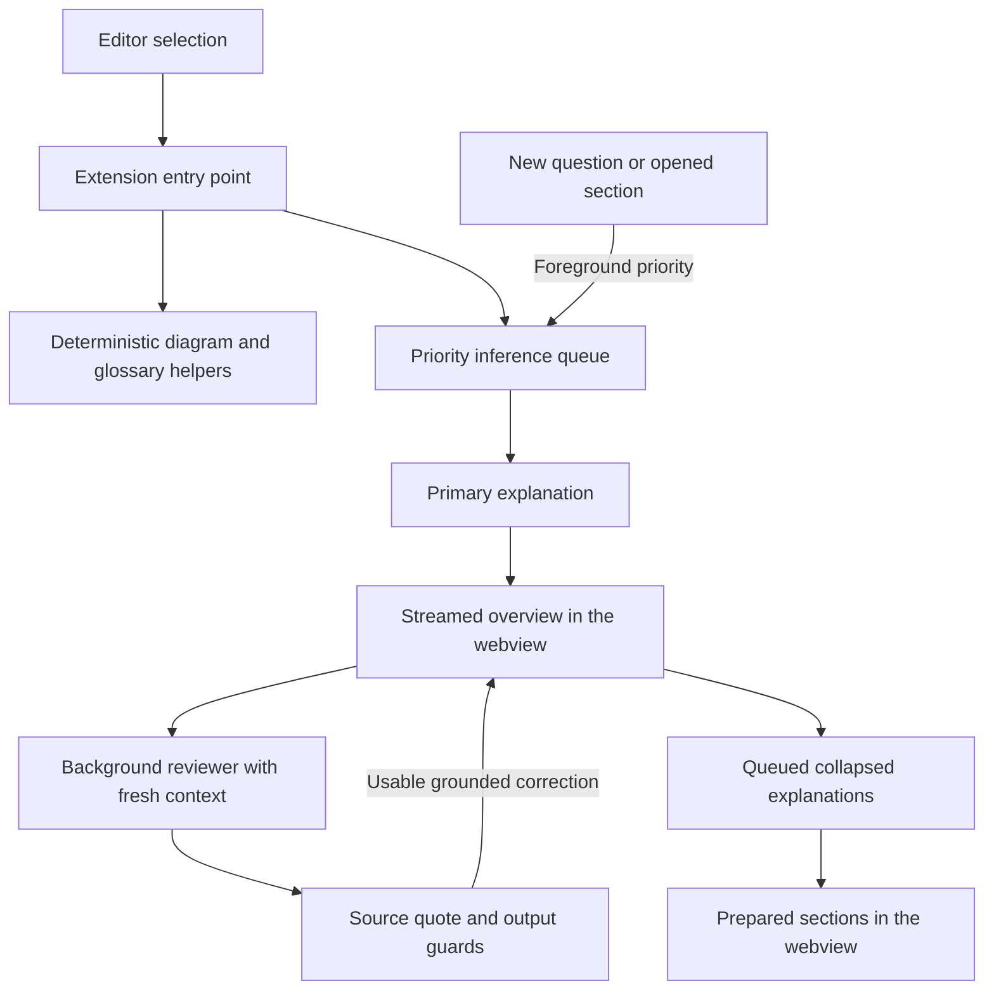

# Agent PIP

A local learning companion for engineers in VS Code and Cursor. Select code, understand the idea behind it, test your understanding, and practise recognising the same pattern elsewhere.

Model requests go to Ollama on `localhost`. The provider rejects remote model URLs. Saved learning notes and review history live in the editor's extension storage, not in the project repository.

## Use PIP

Install the latest VSIX, reload the editor window, and open PIP from the activity bar. Select code and press **Select**. `Cmd+Shift+L` also explains an editor selection.

- **Learn** streams the overview first. Analogy, Foundations, Roots & history, and Performance prepare in the background while you read. Opening a waiting section gives it priority. Terminology links prioritise specific operators such as LIKE and specialised concepts, while common labels such as SQL and HTTP stay plain. This uses local priority tiers, not measured global frequency percentages. A popup explains the concept with a small example.
- **Visualise** has its own tab. **Visualise selection** draws up to 100,000 selected characters immediately, without a model call; larger selections ask you to select less code. JUnit test classes show same-class @BeforeEach setup, independent @Test methods and assertions found in source. This is not a record of test runs or branch coverage. Select a single test for a source-order sequence sketch. The JUnit recogniser handles ordinary @Test and @BeforeEach declarations, not parameterized tests or inherited setup. Choose the views supported by the selected code; unhelpful dependency, circuit and wireframe views are hidden. Recognised string-processing chains get a labelled estimate of character work rather than a benchmark. Ask PIP about the current diagram using its selected code and diagram context. Add an optional business goal or constraint to discuss responsibilities, alternatives and costs against that goal. Performance growth includes a clickable **How to count requests** guide with browser and Vitest steps; request counts are not timings or database query counts. **Load coverage** accepts Vitest/Istanbul `coverage-final.json` and JaCoCo XML reports (up to 5 MB). Coverage must match the selected source file: it does not map a test to all production paths. Coverage stays unknown without matching evidence; JaCoCo line totals do not identify individual true/false outcomes. Rerun coverage after changing the source.
- **Solve** accepts a written problem and optional logs or selected code. In the Solve tab, select code and press Select to attach it; remove the selection when it is not relevant. Solve with me proposes a hypothesis and question, then checks your answer against the supplied evidence. Give me an answer offers a direct response. Both suggest ways to validate, without claiming a test has run. Drafts and selected context are restored when the webview is recreated. When asked to compare two explicitly named test files, PIP reads bounded, uniquely resolved workspace files and compares labelled test excerpts; unavailable, ambiguous or oversized files are reported. The excerpts omit some setup and lines, so inspect the full tests before removing overlap. **Why this suggestion?** shows quoted clues, where they came from, and what remains unknown. Verified workspace file links open in the editor. Rubber-duck feedback checks your explanation against the available context.
- **Ideate** proposes improvements and small experiments. **Ask** explores one idea; **How to spot this** teaches an observation, a hypothesis, an alternative, and a test that could disprove it. Experiments need an observable prediction and rejection criterion, tied to the supplied user outcome or business problem, including an edge case. Plans ask you to justify the chosen boundary and compare an alternative; missing business context is a question to resolve, not a benefit to invent. Diverge, Metaphor, Subtract, and Reverse offer different ways to question a design.
- **Review** holds only the ideas you press **Keep** on; nothing is added automatically. Each card says what it will drill (a question you answer in your own words, a quiz, or a fill-in-the-blank), shows New / Practising / Solid progress, and has a visible ✕ with Undo. Missed concepts come first. Saved ideas remain hypotheses until checked. Filter practice by **SQL & Data**, **TypeScript & Frontend**, or **Java & Backend**. A card infers its layer from the file extension; its Practice layer selector lets you change that choice. Questions focus on mechanisms, edge cases and design decisions in that layer. The layer definitions live in `src/learning/review.ts`. Daily summaries use separate retrieval questions grounded in kept or practised notes; earlier summaries are reconstructed from saved ideas rather than replaying unverified model claims.

**Solve** is a thinking coach, not a solution generator; use Cursor for that. Pair asks you questions. Debug works as the scientific method: it restates the symptom, lists up to three hypotheses with the cheapest check for each, and asks what you observed. It never gives the fix. Each reply starts from a repository search, with counted facts about where identifiers really appear and, if `pip.semanticSearch` is on and `ollama pull nomic-embed-text` has been run, a search by meaning. **Hand off to Cursor** sends your problem, what you have ruled out and the relevant file locations to Cursor's chat (a deep link in Cursor, the clipboard elsewhere).

Voice & Mode, Commands & shortcuts, and Collapse all are compact controls at the bottom. Buttons, tabs and expanders have visible hover and keyboard-focus tooltips. Finishing a timebox pulses the timer and plays a short chime; its sound toggle can mute future chimes.

## How a learning request moves through the system



The first answer does not wait for the background review or collapsed sections. The queue allows one local inference at a time. Foreground requests can interrupt speculative preparation; queued work resumes afterward. Deep sections are deduplicated and cached. Foundations must teach a transferable CS, design or testing principle with source evidence and a small application exercise; analogies must map concrete roles and state a limit; trade-offs need a benefit, cost and choice, or an explicit statement that none is established. Overview echoes fail these checks. Known concepts such as SQL LIKE wildcard escaping use checked teaching templates for analogy, scaling and trade-offs, avoiding unnecessary model calls.

Every learning selection has a session ID and a bounded code snapshot. A new selection cancels the old session. The backend and webview ignore stale results, so an earlier answer cannot overwrite the current selection. Errors clear pending states and allow a retry.

The background reviewer gets the answer and source excerpt in a fresh conversation. It does not receive the author's conversation, use tools, run tests, or inspect a live system. The same configured local model can serve both roles. A matching source quote and a usable correction are required before replacing the displayed explanation; otherwise the answer stays unchanged; routine no-change review messages stay out of the lesson. Explanations are never saved automatically: **Keep** is the only way an idea enters Review, so the list holds what you chose to learn. This is an additional check, not proof that an explanation is correct.

Ideation uses a similar author/reviewer separation. Code rejects unsupported quotations and caps unmeasured performance claims at speculation. A refuted idea cannot be planned or saved as a lesson.

## Source layout

`src/extension.ts` remains the VS Code entry point and composes the domains. Compiled activation still starts at `out/extension.js`.

```text
src/
  extension.ts       VS Code activation and message orchestration
  agents/            Shared prompt context and composition exports
  learning/          Learning memory, terminology, and explanation quality guards
  solver/            Diagnostic evidence, hypotheses, and verified file references
  ideation/          Idea review, experiment quality, and thinking scaffolds
  diagrams/          Diagram extraction, view selection, and verification suggestions
  platform/          Local model provider, persistence, and inference queue
  ui/                Webview markup, panel/sidebar adapters, and UI behaviour tests
  shared/            Common types and existing cross-domain response parsers
  integration/       Tests covering several domains and extension message flows
media/                Browser-side behaviour, diagram rendering, styles, and assets
scripts/              Packaging command
dist/                 Generated VSIX installers; previous builds in archive/
out/                  Generated JavaScript; edit src/ instead
```

If you want to read the code, start with these files:

- [`src/extension.ts`](src/extension.ts): follow a webview message into the domain it uses; `doExplain`, `prepareLearning`, and `prepareDeep` show the Learn lifecycle.
- [`src/learning/prompts.ts`](src/learning/prompts.ts) and [`learning-quality.ts`](src/learning/learning-quality.ts): what the model is asked to teach and what the application checks before showing it.
- [`src/platform/inference-queue.ts`](src/platform/inference-queue.ts) and [`provider.ts`](src/platform/provider.ts): why foreground work wins, how cancellation works, and how requests reach Ollama.
- [`src/solver/solver.ts`](src/solver/solver.ts): how pasted diagnostics become quoted evidence and a possible cause.
- [`src/ideation/ideation.ts`](src/ideation/ideation.ts): how suggestions are challenged and weak experiments get a controlled trial instead.
- [`src/diagrams/diagram.ts`](src/diagrams/diagram.ts) extracts source relationships; [`visualise.ts`](src/diagrams/visualise.ts) prepares the different views and reads imported branch evidence.
- [`src/ui/banner.ts`](src/ui/banner.ts) defines the interface; [`media/learn.js`](media/learn.js) handles browser events and rendering; [`media/panel.css`](media/panel.css) styles it.

Feature tests live beside their modules; integration tests check the boundaries between domains. `shared/evaluator.ts` contains response parsers and helpers used by several domains. Prompt implementations live in each domain's `prompts.ts`; `agents/context.ts` holds their shared context formatter and `agents/prompts.ts` is the small composition export.

Diagrams are deterministic sketches of the selected excerpt. View selection hides empty Architecture views and can offer Sequence or Dependencies instead. Source order is not a proven execution trace; the analyser is not a full Java parser or control-flow analyser. File-context views include visible imports and receivers from the open source file, not a full project-wide call graph. Security views require explicitly named guard calls worth tracing, not just any request or query. Sequences use participant lifelines and preserve repeated interactions in source order; source order alone is not a runtime trace. Request assertions can show a separate chart of their expected counts, never measured traffic. Wireframe depth is a layout choice; Performance growth compares general n, 2n and n² curves for any selection; these are learning examples, not measured performance or inferred complexity. When the selected code contains a recognised trim/uppercase chain, Code estimate adds a separate, simplified model of those operations.

## Develop and install

Run Ollama locally with the model configured in `pip.model` and `pip.fastModel`. Using the same model for both avoids unnecessary model swaps. The default is `qwen2.5-coder:3b`; a larger local model may improve answers at a latency cost. The Solve chat and idea challenges use `pip.reasoningModel` (default `qwen2.5-coder:7b`) and fall back to `pip.model` if it is not installed; explanations and popups stay on the fast model.

```bash
npm install
npm run compile
npm test
npm run package:vsix
code --install-extension dist/agent-pip-0.11.6.vsix --force
cursor --install-extension dist/agent-pip-0.11.6.vsix --force
```

After installation, run **Developer: Reload Window** in the editor. Reloading alone does not rebuild source changes or replace an installed extension. To work directly from the checkout, launch **Run PIP Extension** from the repository's VS Code debug configuration.

Tests cover response contracts, evidence guards, priority/cancellation behaviour, diagrams, UI messages, and extension flows. Small-model output can still be wrong: inspect the cited excerpt and run the suggested check before relying on a diagnosis or proposed change. Model unavailability is shown explicitly rather than presented as a successful assessment.

## Roots & history lookups

Roots may read the introduction of one Wikipedia page, chosen from a fixed list of programming topics (SQL, `EXISTS`, `NULL`, exception handling and so on). Only the page title is sent: never your code, identifiers or questions. Only `en.wikipedia.org` is contacted, with a 6 second timeout, and the local model writes the story from that intro alone. A story whose years are not in the page is discarded for the built-in one, and the source link is shown. Set `pip.webRoots` to false to stay fully offline. Everything else, including every model call, remains local.

## Ideate and Visualise use the repository and the query itself

- **Ideate** searches the repository before it challenges your idea (snake_case SQL names are also searched as `PartnerStatus`-style names). It shows what the repository already settles, such as an enum, a union type or a list that fixes the allowed values of something, with clickable file:line links, and drops questions those lists already answer.
- **Visualise** reads a selected SELECT statement (a Java text block, a string or a .sql file). Data flow draws its parameters, EXISTS subqueries, filters, table, sort and result. The performance view lists the choices found in that query, riskiest first, with a reminder to confirm with EXPLAIN. Neither view is an execution plan or a measurement. Other code keeps the existing views.
